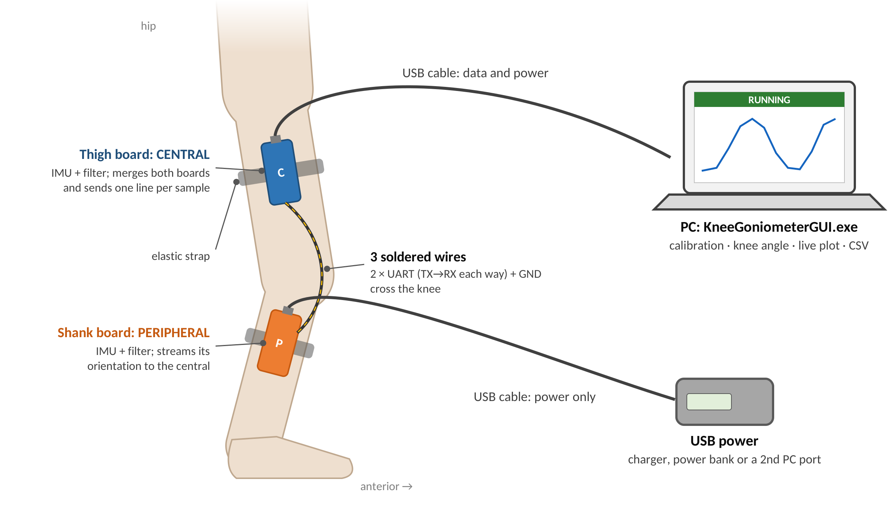
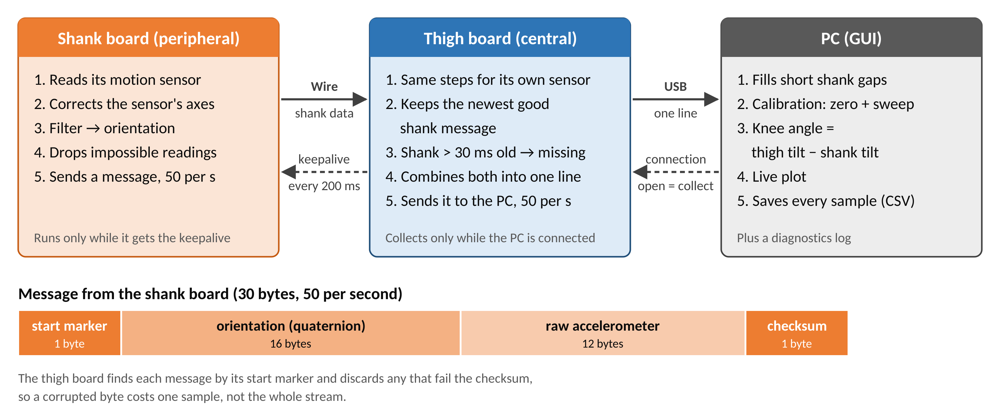
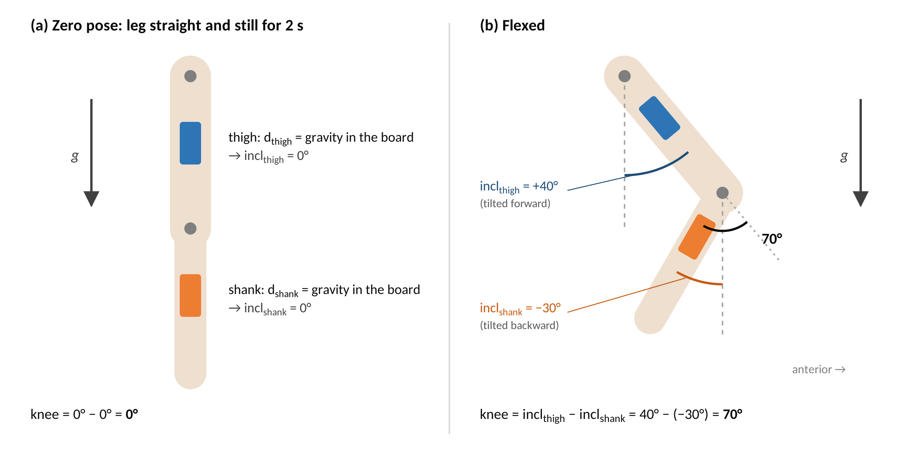
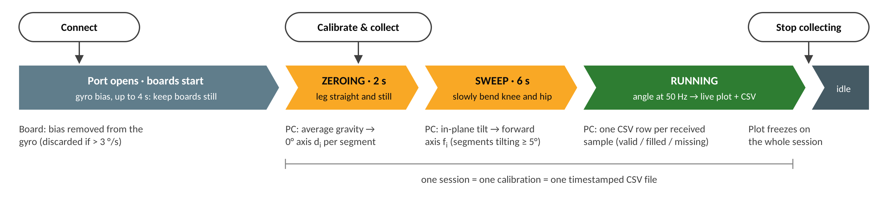

*Drafted in October 2026, prepared by Jamie Kim*

# About this document

This is the handover record for the dual-IMU knee goniometer proof of concept
(August–October 2026). It is composed of the following:

- **Handover summary (§1):** the state of the project at transition, open
  issues, and what to do next. Read this first.
- **Design decisions (§2–§11):** what was decided, why, and which alternatives
  were considered.
- **Areas to explore (Appendices A–D):** longer analyses of directions that were
  weighed but not pursued yet.

**Reading without a technical background.** Each section opens with a short
*In short* summary in plain language; the bullets below it give the detail for
whoever maintains the device. Technical terms are explained in the Key terms
table below.

Companion documents:

- `docs/SOP_Build_and_Use.docx` (`.md` mirror) — how to build and operate the
  prototype and the interface.
- `README.md` — the technical reference (math, wire protocol, commands).
- `analysis/static_test/Static_Stability_Test_Report.docx` — the Preliminary
  Stationary Test Report, with `FINDINGS.md` as its detailed working record.

## Key terms

| Term | Meaning |
|---|---|
| IMU (inertial measurement unit) | A small motion-sensor chip. The one used here (BMI270) contains an accelerometer and a gyroscope. |
| Accelerometer | Measures acceleration, including gravity. When the board is still, it shows which way is down. |
| Gyroscope ("gyro") | Measures how fast the board is rotating. Good for quick movements, but small errors add up over time. |
| Magnetometer | Measures the magnetic field, like a compass. Present on the board (BMM150) but not used. |
| Orientation | How a board is tilted and turned in space. Stored as a *quaternion*, a set of four numbers. |
| 6-DOF / 9-DOF | Fusion from accelerometer + gyroscope (6 measured axes), or with the magnetometer as well (9). |
| Drift | A slow, steady error that builds up over time even when nothing moves. |
| Gyro bias | The small rotation a gyroscope reports when it is actually still; the main cause of drift. |
| Heading (yaw) | Which way a board faces when turned about the vertical, like a compass direction. Gravity cannot tell this. |
| Sagittal plane | The side-view plane in which the knee bends and straightens. |
| Flexion / hyperextension | Bending the knee (positive angle) / straightening it past straight (negative angle). |
| Central / peripheral | The thigh board (central) collects data from the shank board (peripheral) and sends both to the PC. |
| Firmware | The program running on each Arduino board (an Arduino "sketch"). Changing it means *reflashing* the board. |
| UART / serial link | The simple wired connection between the two boards; *baud* is its speed in bits per second. |
| Packet / checksum | One message sent between the boards / a check number that reveals a corrupted message. |
| Calibration (zeroing, sweep) | The short routine at the start of each session that tells the software how the boards sit on the leg (§5.3). |
| GUI / CLI | Graphical user interface (the windowed program) / command-line interface (text commands in a terminal). |

# 1. State at transition (October 2026)

## 1.1 Current state

- **Working bench prototype.** Two Arduino Nano 33 BLE Rev2 boards (thigh =
  central, shank = peripheral) in 3D printed cases (`DualIMU_Goniometer.stl`),
  joined by soldered UART wires, each powered over USB; the central streams to a
  PC at 50 Hz.
- **Interface built for testing.** Live Graphical User Interface (GUI) with
  guided calibration and auto-saved sessions; command-line (CLI) collector;
  self-tests pass. The GUI is released as a Windows program,
  `KneeGoniometerGUI.exe`
  ([Link](https://github.com/Jamie215/DualIMU_Goniometer/releases)).
- **Preliminary stationary testing done.** ≈0.01–0.02° noise, ≈ −0.001 °/min
  drift on healthy hardware; 45°/90° rigs read 45.0°/89.0° (preliminary; §9.1).
- **Standard Operating Procedure (SOP) developed**
  (`docs/SOP_Build_and_Use.docx`): build, setup, sessions and troubleshooting
  for operators; Python setup and releasing a new GUI version are in its
  appendices.

## 1.2 Open issues

1. **Faulty board.** One board's BMI270 fails after 20–40 min (§9.1). It must be
   identified and replaced. It should be the board without the red wire soldered
   to the 3.3 V pin; confirm before replacing it.
2. **Raw test data not preserved.** The stationary-test CSVs and diagnostic logs
   were not archived (`*.csv` / `*.log` are git-ignored intentionally during
   development phase). Plan data storage once testing moves beyond the
   preliminary stage.
3. **Peripheral-only fault guard.** The sensor-fault guard runs on the
   peripheral only; the central has no equivalent (§7.2).
4. **Angle log resolution.** Angles are written to 0.01°, which limits how low
   a noise floor can be measured.

## 1.3 Recommended next steps

1. Replace the faulty board; repeat a one-hour stationary run on two healthy
   boards for a clean baseline.
2. Sweep **both** nodes during calibration so the angle uses both sensors (§5.3)
3. Try the strap placement in the SOP on a person and refine it if the boards
   shift during movement.
4. Controlled accuracy test: repeated 0°/45°/90° placements on a precise rig or
   against a goniometer.
5. Dynamic range-of-motion testing (tune `TWO_KP` and the soft accel gate, §4.3,
   if fast reps lag or overshoot).
6. Consider the longer-term directions in §10 and Appendices A–D (battery +
   Bluetooth for an untethered device; absolute angle via functional calibration).

## 1.4 Documents & files reference

| Document | Use it for |
|---|---|
| `docs/SOP_Build_and_Use.docx` (master; `.md` mirror) | Building the device and running a session |
| `docs/Project_Handover.md` (+ `.docx`) | This document: state, design rationale, future directions |
| `analysis/static_test/Static_Stability_Test_Report.docx` | Preliminary Stationary Test Report |
| `analysis/static_test/FINDINGS.md` | Detailed working record behind the report |
| `README.md` | Technical reference: math, wire protocol, commands |

| File / folder | Contents |
|---|---|
| `central_imu/central_imu.ino` | Thigh board firmware |
| `peripheral_imu/peripheral_imu.ino` | Shank board firmware |
| `knee_collector_uart.py` | Angle math, calibration, CLI collector, `--selftest` |
| `knee_gui.py` | Live GUI (uses `knee_collector_uart.py`) |
| `requirements.txt` | Python dependencies |
| `DualIMU_Goniometer.stl` | 3D printable board case (base + lid) |
| `analysis/static_test/` | Stationary Test Report, its figures, and the analysis scripts behind them (reusable for future stationary tests) |
| `analysis/diagnostics/parse_diag.py` | Diagnostic log → tables |
| `docs/` | SOP, this document, and its figures (`docs/images/handover/`) |
| `docs/build_docs.sh` | Regenerates this document's `.docx` from its Markdown |
| `.github/workflows/release.yml` | Builds `KneeGoniometerGUI.exe` on a `v*` tag |

# 2. Problem and goals

The goal is a low-cost wearable that measures **knee flexion angle** from two
inertial sensors, one above and one below the knee.

| Goal | Explanation |
|---|---|
| Placement independence | The boards should not need to be mounted at a precise or repeatable orientation on the limb. |
| Robust signal | The collected signals should be stable at rest, smooth through motion. There should be no drift in the angle. |
| Simple design | Prefer the smallest system as a proof of concept that can be easily built and tested. |
| Usable in testing sessions | A GUI that drives calibration, shows live data, and saves every session automatically. |

Scope: **sagittal-plane** knee flexion (standing range of motion, gait,
sit-to-stand), relative to a calibration pose. Absolute anatomical angles and
3-D kinematics are out of scope (see §5.5 and §10).

# 3. System architecture

*In short:* one motion sensor sits on the thigh and one on the shank. The shank
board sends its readings to the thigh board through a wire; the thigh board
adds its own and passes both to the PC, which works out the knee angle, shows
it live and saves it (Figures 1 and 2).





## 3.1 Two boards, one connection to the PC

- **Design Decision:** The thigh board (*central*) works out its own orientation,
  receives the shank board's (*peripheral*) orientation over a wire, and sends
  both to the PC as one line per sample. The PC calculates the angle.
- **Why:** The thigh and shank readings must belong to the same moment. At 50
  samples per second a new sample arrives every 20 ms, so even a small mismatch
  between the two boards would pair readings taken at different times and
  distort the angle during movement. Merging on the thigh board means each line
  already holds a matched pair when it reaches the PC. Of the ways to keep the
  two in step, this was the simplest and the most reliable. It also means only
  one board is plugged into the PC, and the angle calculation stays on the PC,
  where it can be tested and changed without reprogramming the boards.
- **Alternatives:** Plugging each board into the PC separately, which would
  leave the PC to line up two independent streams in time; calculating the angle
  on the board (harder to test and change).

## 3.2 Hardware

- **Design Decision:** Arduino Nano 33 BLE Rev2, using its built-in BMI270 motion
  sensor (accelerometer + gyroscope). Its built-in magnetometer is not used
  (§4.1).
- **Why:** Off-the-shelf and inexpensive, with the sensor already on the board,
  familiar Arduino tools, and a Bluetooth radio for a future wireless version.

## 3.3 Physical build

- **Design Decision:** Printed cases and elastic straps; the boards are joined by three
  soldered wires. The thigh board is powered and read through one USB cable to
  the PC; the shank board has its own USB power.
- **Why:** The quickest way to a working, reliable bench prototype.
- **Trade-offs:** The person is tied to the PC and to power, and a wire runs
  across the knee. Batteries and wireless links are future work (Appendix C).

# 4. Sensor fusion (on each board)

*In short:* each board turns its raw sensor readings into a steady estimate of
how it is tilted. These choices keep that estimate stable at rest and accurate
during movement.

*Note for maintainers:* the Arduino library for this sensor reports its axes as
a mirror image of the real directions, so the firmware flips one axis (x) of the
accelerometer and gyroscope after reading them. This is a bug fix rather than a
design choice, but **any new firmware must keep it** (README, finding #1).

## 4.1 Accelerometer + gyroscope only, no magnetometer

- **Design Decision:** Each board estimates its orientation by combining the
  accelerometer and gyroscope (a 6-DOF Mahony filter, settings `TWO_KP = 1.0`,
  `TWO_KI = 0.04`).
- **Why:** The angle method (§5) only needs to know which way gravity points
  for each board, and these two sensors give that without drift. A magnetometer
  is sensitive to the nearby environment (furniture, treadmills, cables, the
  other board) and needs extra calibration for each board.
## 4.2 Measuring gyroscope bias at the start, with a safety check

- **Design Decision:** When a collection starts, the board averages about 300 gyroscope
  readings (up to 4 s) and subtracts that as the bias. If the result is larger
  than 3 °/s on any axis, it is thrown away instead.
- **Why:** Bias is the main source of drift. A result that large means the board
  was moving rather than still, and using it would make things worse.

## 4.3 Trusting the accelerometer less during fast movement

- **Design Decision:** The accelerometer's influence is gradually reduced the further
  its reading is from normal gravity: full trust within 0.10 g of 1 g, none
  beyond 0.60 g.
- **Why:** During quick movements the accelerometer feels the movement as well as
  gravity, so it no longer points cleanly "down". Switching it fully off and on
  instead would let the angle drift during a fast move and then jump back.
- **Status:** Not yet tuned on real movement data.

# 5. Knee-angle method (PC side)

*In short:* the PC measures how far each segment has tilted from the pose held
at the start, using the direction of gravity seen by each board. The knee angle
is the thigh's tilt minus the shank's tilt (Figure 3). Because only tilt relative
to gravity is used, the boards do not need to be placed precisely.

## 5.1 Measuring each segment's tilt against gravity



- **Design Decision:** For each board, find which way gravity points in that board's
  own frame, turn that into a signed tilt (inclination) in the side-view plane,
  and take the knee angle as `incl_thigh − incl_shank` (Figure 3).
- **Why:** Tilt measured against gravity does not drift, and it does not depend
  on which way the person is facing (heading), the one thing these sensors
  cannot track reliably. How each board is mounted cancels out, so placement does
  not need to be exact.
- **Alternatives:** (a) Comparing the two boards' full orientations directly —
  rejected because each board's heading drifts separately, so the angle drifted
  even with both boards fixed to one ruler. (b) Several selectable angle methods
  — reduced to one so that one method's problems could not hide another's.

## 5.2 Gravity from the filter, not the raw accelerometer

- **Design Decision:** Take the gravity direction from the filtered orientation (§4.1).
  The raw accelerometer readings are still saved, as an independent check.
- **Why:** The raw accelerometer is disturbed by movement; the filter uses the
  gyroscope to follow fast movement while the accelerometer keeps the tilt from
  drifting.

## 5.3 Two-step calibration: hold still, then move



- **Design Decision:** Each session starts with (Figure 4):
  1. **Zeroing** (2 s): leg straight and still. The gravity direction each board
     sees becomes its 0°.
  2. **Sweep** (6 s): a few slow movements bending the knee and hip. The
     direction each board tilts becomes its "forward".
- **Why:** Together these tell the software how each board sits on its segment,
  without anyone having to measure the mounting.
- **Detail:** A segment that tilts less than 5° during the sweep is treated as
  not moving and contributes 0°. In all bench tests only the shank was moved, so
  the angle came from the shank alone; moving both segments is a required next
  step (§1.3).

## 5.4 Signed, continuous angle

- **Design Decision:** Bending reads positive and over-straightening reads negative,
  with no jumps anywhere in the range (calculated as `atan2(g·f, g·d)`).
- **Why:** It tells bending apart from over-straightening and gives the same
  readings on the way back from deep bending (checked by the self-test with a
  0° → 130° → 0° movement).

## 5.5 Angles relative to the start pose, not anatomical angles

- **Design Decision:** Accept that 0° means "the pose held during zeroing", not "the
  leg is anatomically straight".
- **Why:** Range of motion, repetition counting, gait and movement quality all
  use differences between angles, so the starting point cancels out. A true
  anatomical angle (for example, measuring a knee that cannot fully straighten)
  needs an outside reference that sees the anatomy; the sensors cannot provide
  it, and a magnetometer would not help (Appendix A).

## 5.6 Accepted limitation: side-view plane only

Gravity shows tilt but not rotation about the vertical. The method therefore
under-reads movement well outside the side-view plane (for example, lying down
with the hip turned a lot). This is accepted because the target is ordinary
knee bending while upright.

# 6. Board-to-board link and data protocol

*In short:* how the two boards talk to each other and to the PC. The choices
favour reliability: a lost or corrupted message costs one sample instead of
breaking the stream, and neither board ever waits on the other.

## 6.1 Wired serial link at 115 200 baud

- **Design Decision:** A wired UART link at 115 200 bits per second in both directions:
  shank data to the thigh board, and a "keep going" signal (keepalive) back to
  the shank board (Figure 2).
- **Why:** Simple and predictable. 115 200 is far more than needed (about
  15 000 bits per second) while leaving a wide timing margin; faster speeds were
  less reliable as the boards warmed up.

## 6.2 Messages with a start marker and a check number

- **Design Decision:** Each 30-byte message (packet) starts with a fixed marker byte and
  ends with a checksum (Figure 2). The thigh board finds the start of each
  message by its marker and discards any message whose checksum is wrong.
- **Why:** Without a marker, one lost byte would scramble every message after it;
  with it, a glitch costs a single sample.

## 6.3 The shank board keeps sending; the thigh board never waits

- **Design Decision:** The shank board sends a message 50 times a second without being
  asked; the thigh board always uses the newest good one. If that is more than
  30 ms old, the shank reading is marked missing and the PC fills the gap (§8.3).
- **Why:** If the thigh board had to ask and wait, any short pause on the shank
  board would lose samples or hold up the thigh board. Streaming keeps the two
  boards independent.

## 6.4 Collecting only while the PC is connected

- **Design Decision:** The sensors run only while the PC has the thigh board's USB
  connection open. The thigh board then measures its gyroscope bias and sends a
  keepalive every 200 ms; the shank board stops if it hears nothing for 1 s.
- **Why:** Nothing runs unobserved, and every session starts with a fresh bias
  measurement taken while the boards are still (Figure 4).

## 6.5 A steady 50 samples per second

- **Design Decision:** Both boards send at a fixed 50 Hz; the sensors and filters
  still run faster internally. The thigh board sends each line to the PC in a
  single write (~1–1.8 ms), well within the 20 ms between samples.
- **Why:** 50 Hz is plenty for knee movement and leaves comfortable timing
  margin on both boards.

## 6.6 Health reports (diagnostics)

- **Design Decision:** Both boards report a short health summary once a second (on by
  default). The GUI saves these to `knee_diag_<timestamp>.log`, and
  `analysis/diagnostics/parse_diag.py` turns them into tables.
- **Why:** These reports found the sample-rate shortfall and the faulty sensor.
- **Constraint:** Both boards must run firmware from the same version, because
  the report format must match exactly.

# 7. Robustness and fault handling

*In short:* the shank board watches its own sensor and restarts it when it
misbehaves, and it sends a gap rather than a wrong reading. The LEDs show what
each board is doing.

## 7.1 Shank board self-repair

- **Slow start:** if the sensor delivers fewer than 30 readings in its first
  second (it occasionally starts at ~10 Hz), it is restarted.
- **Stalled sensor:** if no reading arrives for 250 ms, the LED stays on and the
  sensor is restarted every 500 ms.
- **Sensor not found at power-up:** the LED blinks fast for ~3 s and the board
  restarts.

## 7.2 Rejecting impossible readings

- **Design Decision:** The shank board rejects a reading that took too long (over
  50 ms) or is physically implausible (acceleration below 0.25 g or above 4 g, or
  very fast rotation while the board is otherwise near rest). A rejected reading
  is sent as a gap. If no good reading arrives for 5 s, the board restarts.
- **Why:** In long tests one board's sensor began returning nonsense after
  20–38 min and then stopped; this turns wrong angles into visible gaps.

## 7.3 LED indicators

| Board | Pattern | Meaning |
|---|---|---|
| Central | On | Collecting (USB port open) |
| Central | Off | Idle |
| Peripheral | 3 quick flashes | Starting up |
| Peripheral | Slow blink | Idle, waiting for the start signal |
| Peripheral | Fast blink (~3 Hz) | Active, sending data |
| Peripheral | Solid on | Sensor stalled (being restarted) |
| Peripheral | Off / frozen | No power or a serious fault |

# 8. PC software

*In short:* operators use a Windows program that walks them through calibration,
shows the angle live and saves every session to its own file. Every reading
received is saved once, and gaps are marked rather than hidden.

## 8.1 One calculation engine, two front ends

- **Design Decision:** `knee_collector_uart.py` holds the angle math, calibration, file
  saving and self-test; `knee_gui.py` (the GUI) reuses it and adds port
  selection, a colour-coded instruction banner, live plots and automatic saving.
- **Why:** The math exists in one tested place, and the GUI makes sessions easy
  and repeatable for people who are not developers.

## 8.2 Sessions and saved rows

- **Design Decision:** Each "Calibrate & collect" starts a new session with a fresh
  calibration and a new time-stamped CSV file; "Stop collecting" freezes the plot
  so the whole session can be reviewed (Figure 4). Exactly one row is saved per
  reading received, timed by the board's clock.
- **Why:** Each file then has exactly one calibration, and rows follow the
  board's evenly spaced samples rather than the PC's timer, which runs unevenly
  on Windows and would duplicate or skip rows.

## 8.3 Short gaps filled, long gaps marked

- **Design Decision:** If up to 10 shank readings in a row are missing, the last good
  value is repeated (forward-filled); longer gaps are left empty. Every row
  records whether it is `valid`, `filled` or `missing`.
- **Why:** Plots stay readable, and it is always clear which data were real.

## 8.4 Clear error messages

If no good data arrive, the software says which part is failing: nothing coming
from the USB port, wrong or out-of-date firmware, or no data from the shank
board.

## 8.5 Windows program, built automatically

- **Design Decision:** The GUI is shipped as a single Windows program,
  `KneeGoniometerGUI.exe`, built automatically by GitHub when a new version is
  tagged. The build runs the self-test first and publishes the program on the
  Releases page (steps: README "Releasing an updated GUI", SOP Appendix B).
- **Why:** Operators do not need to install Python. Each program is tied to an
  exact version of the code, and a failing self-test stops a broken program from
  being released.
- **Alternatives:** Running the Python code directly (too much setup for
  operators); building the program by hand (not repeatable, and easy to include
  untested changes).
- **Trade-offs:** Windows only (macOS and Linux use the Python version); the
  program is not digitally signed, so Windows shows a warning the first time it
  runs.

# 9. Testing and validation

*In short:* with the sensors held still, the angle was very steady (changes of a
few hundredths of a degree) and did not drift on healthy hardware. Long runs
exposed one faulty board. Movement and on-body testing have not been done yet
(§1.3).

## 9.1 Preliminary stationary testing (Sept 2026)

Full results are in the Preliminary Stationary Test Report.

| Test | Result |
|---|---|
| Stability (6 holds of ~5 min) | ~0.01–0.02° noise; no growth in noise over longer periods |
| Endurance (24–60 min) | Stable for 33 min on healthy hardware; ≈ −0.001 °/min drift |
| 45° / 90° rigs (preliminary) | Read 45.0° and 89.0° |
| Sample rate | ~40 Hz found (slow line writing on the thigh board, uneven PC timer); fixed to a true 50 Hz (§6.5, §8.2) |
| Data loss in long runs | Traced to a **faulty sensor on one board**; the other ran over 1 h without problems in either role |

Methods worth keeping:

- **Leave out the first 20 s** of each session when analysing still holds
  (calibration and settling).
- **Swap the boards** to tell a hardware fault from a software fault — the fault
  followed the board.
- **Use the raw accelerometer as an independent check** of real movement; it
  showed that a slow creep in one session was the test rig settling, not the
  sensors drifting.

## 9.2 Earlier bench checks

Fixing both boards to one ruler (so the true angle cannot change) was the key
test for drift; a right-angle placement read ~90°. The self-tests
(`knee_collector_uart.py --selftest`, `knee_gui.py --selftest`) check the math.

# 10. Directions considered but not pursued

*In short:* four ideas were looked at for later. Each is explained in an appendix.

| Area | Recommendation |
|---|---|
| A. Magnetometer | Do not add for knee bending; only worth it if full 3-D movement must be measured, after checking the room for magnetic interference. |
| B. Anatomical angle | Use a calibration movement that finds the knee's hinge axis, or a known straight pose; not built yet. |
| C. Wireless (Bluetooth) | Start with the board-to-PC link; needs time stamps on each reading and batteries. Main benefit is safety and ethics approval. |
| D. More sensors / joints | Needs sensor IDs, a more general data format and time matching across sensors; Bluetooth suits a hub layout. |

# 11. Timeline of major milestones

The commit codes identify each change in the project's version history (GitHub).

| Date (2026) | Milestone | Commits |
|---|---|---|
| Aug 14 | First wired two-board prototype (simple tilt-based angle) | `09f3557`, `4b2fd42` |
| Aug 17 | Angle made independent of board placement; magnetometer version tried | `557ba29`, `146cc14` |
| Aug 18 | Back to accelerometer + gyroscope only; axis correction; gyro bias; gravity-based angle | `0dd3a93`, `6f1bdc7`, `276d9dc` |
| Aug 19 | Single angle method; first live GUI | `4effe4c`, `9ef5550` |
| Aug 20 | More reliable board-to-board link; collect only while connected; 50 Hz | `c767bc7`, `7197327`, `86efe6d` |
| Sep 21–22 | Boards renamed central/peripheral; future directions written up | `d9ccd14`, `170580c` |
| Sep 23–24 | Stationary testing; health reports; sample-rate fix; faulty-reading guard | `99a2446`, `72943ba`, `e02ae6d`, `8a9aaf4` |
| Sep–Oct | Preliminary Stationary Test Report | `70815cf`, `38724bf` |
| Oct 9–13 | Handover documents: SOP, design decisions, handover summary | `d0dd9be`, `82835c7` |
| Oct 13 | Windows program built automatically; version 1.0.0 released; case design added | `572b164`, `a789fd6` |

# Appendix A — Magnetometer: accuracy, and absolute vs. relative angle

*In short:* adding the board's compass sensor would not make the knee angle more
accurate, and it cannot give a true anatomical angle either. It is only worth
revisiting if full 3-D movement ever needs to be measured.

**Status:** Investigated (analysis only). Not recommended for the current use.

## A.1 The proposal

The boards carry a magnetometer (BMM150) that is not used (§4.1). The proposal
was to use it to (a) improve accuracy, and/or (b) get an **absolute** joint angle
instead of the current one, which is **relative** to the start pose — on the
idea that "the magnetometer points to north, so it can be a reference for the
angle between the segments."

## A.2 What a magnetometer actually measures

- The direction and strength of the local magnetic field, as seen by the board.
  Turning the board changes the reading; that change is what reveals its
  orientation.
- The field points to **magnetic** north and also **dips steeply into the ground**
  (about 60–70° at mid latitudes). It is not a neat horizontal arrow; a compass
  hides this by using only the horizontal part.
- The angle between the magnetic field and gravity depends only on **where you
  are on Earth**, not on the leg, so it says nothing about the joint.

## A.3 Two separate jobs: a *scale* and a *zero*

Measuring any angle needs two things:

1. **A scale** — how far apart two directions are (like the markings on a ruler).
2. **A zero** — which position counts as 0°.

Sensors on the body are good at the scale. The zero is a question about the
person's anatomy, not about the sensors. This split is the heart of the
magnetometer question.

## A.4 What the magnetometer would add

- **Heading.** Gravity shows tilt but not which way a board faces; the
  magnetometer supplies that, like a compass.
- With gravity **and** the magnetic field, each board's full 3-D orientation is
  known, and so is the full, drift-free rotation between the two boards.
- **In practice:** its only unique contribution is movement **outside the
  side-view plane**. For ordinary knee bending, gravity alone is enough because
  both boards share the same "down".

## A.5 Why it does not give an anatomical angle

The joint angle is between the **bones**, not between the **boards**. Each board
sits on skin at an unknown angle to its bone. In symbols, with `R_rel` the
rotation between the boards and `M_thigh`, `M_shank` each board's unknown
mounting:

```
joint = M_thigh⁻¹ · R_rel · M_shank
```

The magnetometer pins down `R_rel` but tells nothing about the mountings.

- **Two meanings of "absolute":** absolute *heading* (which way you face), which
  the magnetometer gives; and an absolute *anatomical zero* (the true angle
  between thigh bone and shin bone), which it does not.
- **The deciding example:** two people can hold their legs so that both boards
  give identical readings — accelerometer *and* magnetometer — while one is a
  healthy knee bent 10° and the other a knee that cannot straighten past 10°.
  Same data, different clinical truth, so no calculation on the sensor data can
  tell them apart.
- **"Straight" is not a direction in the room.** A joint angle does not change
  when the person turns around; which way the person faces is the only thing the
  magnetometer adds.

The current method is relative because of the **zeroing hold** (§5.3): whatever
pose is held becomes 0°, and the unknown mounting cancels out.

## A.6 Trade-offs

- **The basic choice:** either *measure* how each board sits on its bone (an
  anatomical zero, but placement must then be careful) or *cancel* it by
  re-zeroing every session (relative zero, placement does not matter). The
  current design cancels it, which is why placement is not critical. The
  magnetometer helps with neither.
- **Magnetic interference:** table and chair legs, treadmills, wheelchairs,
  steel in floors, batteries, the USB cable and the other board all distort the
  field. Clinics and gyms are full of these.
- **Extra calibration:** each board would need a figure-of-eight calibration,
  repeated whenever conditions change.
- **Accuracy gain for knee bending, gait and sit-to-stand:** about none.

## A.7 Next experiments (if revived)

1. **Check the room first:** record the raw magnetic field during a normal
   session *in the actual test space* and plot its strength. If it stays roughly
   constant (~25–65 µT) as the leg moves, the space is clean enough; large swings
   mean the magnetometer would add error.
2. **Compare in 3-D:** bring back the old magnetometer code as an option and
   compare it with the current method on sideways and twisting movements, not
   ordinary bending.
3. Go further only if (1) passes and a 3-D requirement actually exists.

# Appendix B — Anatomical angle via functional calibration

*In short:* to report true anatomical angles (for example, a knee that cannot
fully straighten), the software must learn how each board sits on its bone. A
short calibration movement that reveals the knee's hinge axis can do this. Not
built yet.

**Status:** Identified as the right approach. Not yet prototyped.

## B.1 Motivation

The current angle is relative to the start pose (§5.5), so it cannot report a
clinical angle such as a knee that stops 10° short of straight, or compare
sessions that were zeroed in different poses. As Appendix A shows, this needs a
reference that **sees the anatomy**.

## B.2 Candidate approaches

- **Hinge-axis (functional) calibration:** the person does a few pure
  knee-bending movements. The knee's hinge axis then shows up in each board's
  gyroscope as the main axis of rotation, which reveals how the board sits on the
  bone. No magnetometer is needed; research-grade motion-sensor systems use this
  approach.
- **Known pose / outside reference:** define true full straightening once (with a
  straight-leg fixture, a manual goniometer or imaging) and anchor the zero to
  it.

## B.3 Trade-offs

- Gains an anatomical angle that can be compared across sessions and can show a
  knee that cannot fully straighten.
- Costs more careful placement and a repeatable calibration routine for each
  person (the "measure the mounting" choice in A.6).
- Accuracy depends on how purely the calibration movement bends only the knee;
  it needs checking against a goniometer or another reference method.

## B.4 Next steps

- Build a hinge-axis estimate from a bending-only recording and compare its zero
  with a manually measured angle at known poses.
- Decide whether the clinical use needs anatomical angles at all, or whether
  differences (range of motion, repetitions, gait, movement quality) are enough.

# Appendix C — Wireless (Bluetooth) links

*In short:* the boards already have Bluetooth radios. Using them would remove the
wires, mainly for safety and ethics approval, at the cost of batteries and less
predictable timing. Not investigated in depth.

**Status:** Idea raised; not investigated in depth.

## C.1 Motivation

Two connections could go wireless (Figure 2):

- **Link A — shank board ↔ thigh board:** today the wire that crosses the knee.
- **Link B — thigh board ↔ PC:** today the USB cable.

**Main reason: safety and ethics approval.** Removing wires — especially one
across the joint or one tying the person to a PC — reduces the risk of tripping,
tangling and electrical hazards. It also lets people walk and stand up more
naturally.

## C.2 How

- Bluetooth software on the boards, and a Bluetooth library (such as Python
  `bleak`) on the PC in place of the USB serial connection. Each link can be
  replaced on its own.
- **Link B first:** it removes the tie to the PC without changing the
  board-to-board link. Link A removes the wire across the knee.

## C.3 Things to watch

- **Lost data:** the existing gap handling (§6.3, §8.3) helps, but Bluetooth has
  its own dropouts and reconnections.
- **Timing:** Bluetooth delivers data in bursts (at least 7.5 ms apart) with
  uneven delays, so each reading should carry its own time stamp from the board.
- **Capacity:** 50 Hz is possible but with less spare room than the wire;
  several readings may need to be sent together, or the rate lowered.
- **Simpler messages:** Bluetooth already separates messages, so the start-marker
  logic (§6.2) is not needed; the checksum is still worth keeping.
- **Power:** wireless means a battery on each board (which would also disturb a
  magnetometer if one were ever used).
- **Interference** from other 2.4 GHz devices, and reliable reconnection.

## C.4 Next steps

- Build one link at a time, starting with Link B. Measure the rate, lost data and
  timing against the wired version, and compare the angle traces.
- Decide for each link whether the safety benefit is worth the extra variability
  for the planned study.

# Appendix D — More sensors and joints

*In short:* measuring more than one joint (for example hip, knee and ankle, or
both knees) needs more boards, a way to tell them apart, and careful time
matching between them. Not investigated in depth.

**Status:** Idea raised; not investigated in depth.

## D.1 Motivation

Today one pair of boards measures one knee. Studies may want a **chain** on one
leg (thigh + shank + foot for hip, knee and ankle), **both legs**, or more of the
lower body. Two layouts were suggested:

- **Hub:** several sensor boards send to one hub board, which sends a single
  stream to the PC.
- **Independent pairs:** several of today's two-board units, each measuring one
  joint, combined on the PC.

## D.2 Things to consider

- **Wiring points to Bluetooth (Appendix C).** Each board has only one wired
  serial link, so a wired hub cannot connect several boards; a Bluetooth hub can.
- **Telling sensors apart:** each message needs a sensor ID, and the saved files
  need a general layout for any number of segments and joints.
- **Time matching** is the biggest risk: an angle between two segments needs
  readings taken at the same moment, so all boards need time stamps from a shared
  clock.
- **Capacity:** many sensors at 50 Hz share one link, which may limit the rate or
  the number of sensors.
- **Calibration** gets longer with each segment, so the routine and the GUI must
  scale with it.

## D.3 Layout trade-off

| Layout | For | Against |
|---|---|---|
| Hub | One stream and one clock at the hub; simple on the PC | The hub's capacity is the limit, and if it fails everything stops |
| Independent pairs | Modular; reuses today's firmware | The PC must time-match several streams; more radios or USB ports and more hardware |

## D.4 Next steps

- Define a message with a sensor ID and a general data layout (any number of
  segments and joints) before choosing a layout.
- Build time matching across boards and measure how closely it aligns, against
  the accuracy the study needs.
- Choose by study size: a Bluetooth hub for a compact multi-segment setup;
  independent pairs when modularity matters more.
