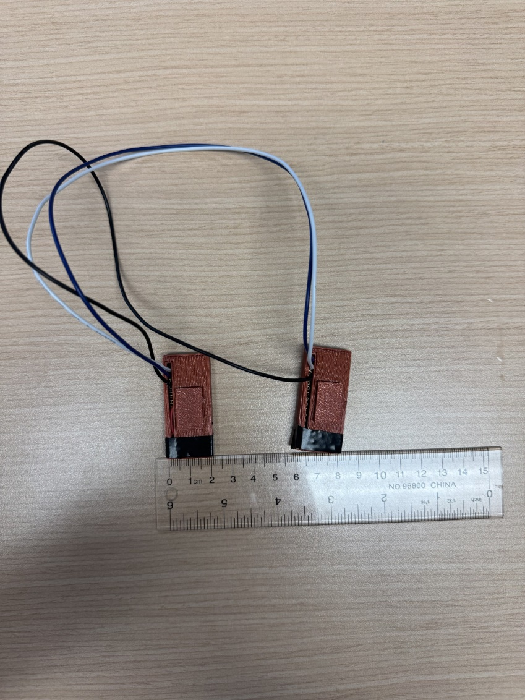
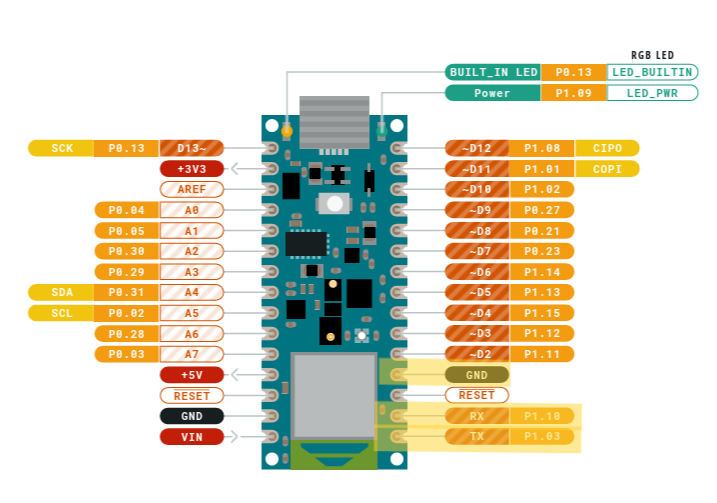
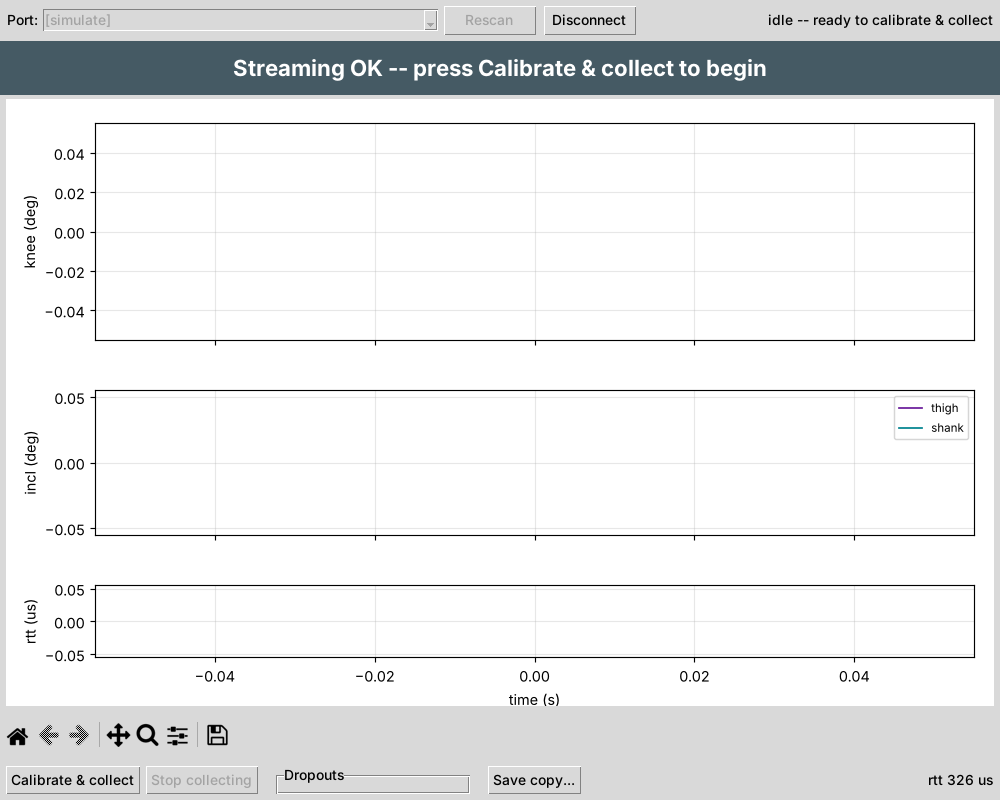
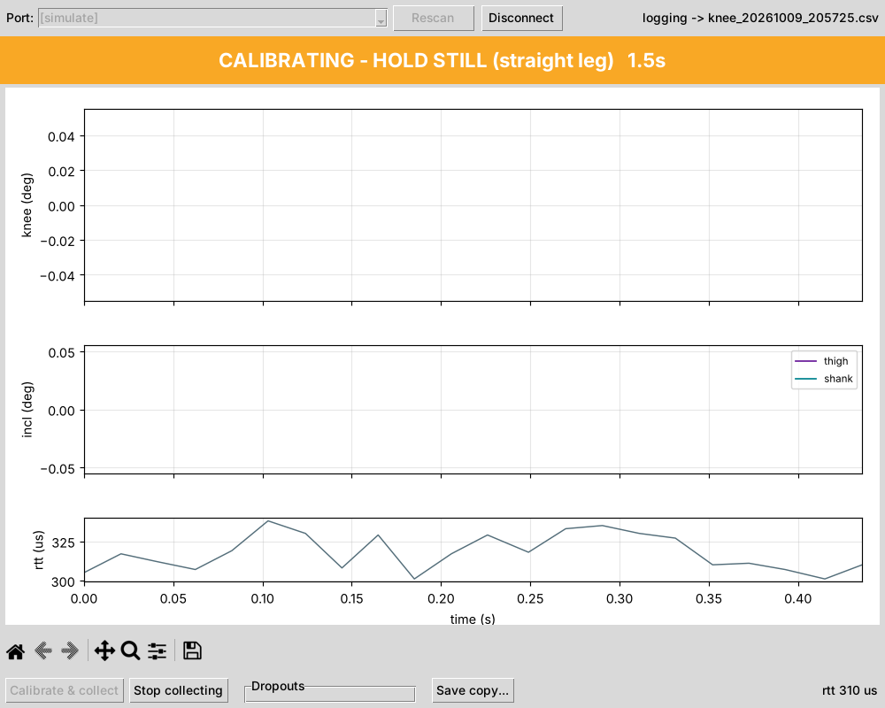
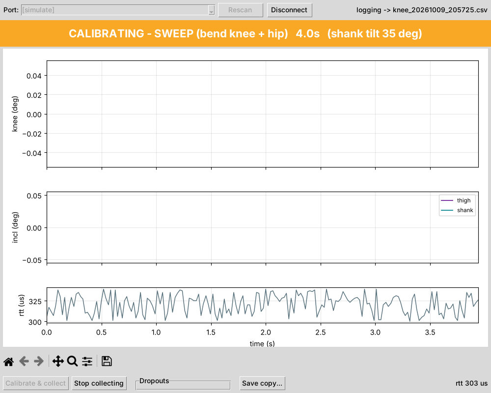
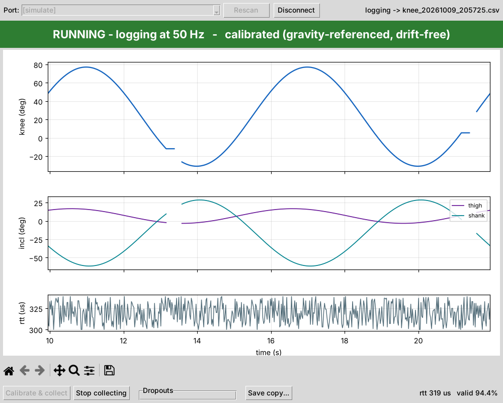
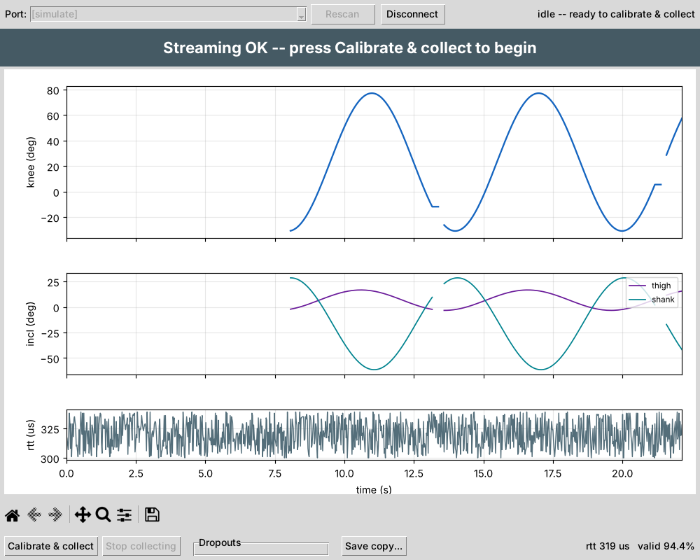

# Dual-IMU Knee Goniometer — SOP: Build and Use

> **The Word file `docs/SOP_Build_and_Use.docx` is the master copy of this SOP.** This
> Markdown is a read-only mirror for viewing on GitHub; edit the Word file, then refresh
> this mirror with:
> `pandoc docs/SOP_Build_and_Use.docx -t gfm --extract-media=docs/images/sop -o docs/SOP_Build_and_Use.md`
> (and change `docs/images/` to `images/` in the image links).

# 1. Purpose and scope

This SOP describes how to build the dual-IMU knee goniometer prototype,
set up its software, and run a data-collection session. It covers the
device as it currently exists: a bench / proof-of-concept prototype with
two cased Arduino boards joined by soldered wires, each powered over
USB, with the central board connected to a PC.

**How it works.** One board sits on the thigh and one on the shank
(lower leg). Each board has a motion sensor that measures how it is
tilted. The shank board sends its readings to the thigh board through
the wires between them; the thigh board adds its own readings and sends
everything to the PC through its USB cable. A program on the PC (the
GUI) turns the two tilts into a knee angle, shows it live and saves it
to a file.

**Key terms used in this SOP:**

• **Thigh board = central board.** The one connected to the PC by USB.
Labelled CENTRAL.

• **Shank board = peripheral board.** Sends its readings to the thigh
board. Labelled PERIPHERAL.

• **Firmware / flashing.** The small program that runs on each board,
and loading it onto the board.

• **Terminal.** A window where you type commands (Command Prompt on
Windows, Terminal on macOS).

• **Virtual environment.** A private Python workspace for this project,
so its add-ons do not affect anything else on the PC.

• **Port.** The name the PC gives a board plugged in by USB (e.g. COM5
on Windows).

• **Calibration.** The short hold-still and leg-movement steps at the
start of every session, which tell the program how each board sits on
the leg.

> **Safety and use limits.** This is a research prototype. It is
> connected by cable to a computer and to USB power, and a wire runs
> across the knee. Use it on the bench or for supervised, low-risk
> movement only, and keep cables clear of feet and furniture. For a real
> test deployment, consider a wireless version.

Figure 1. MSK-IF version research prototype

# 2. Materials

| **Qty** | **Item**                            | **Notes**                                                                                                                                                                   |
|---------|-------------------------------------|-----------------------------------------------------------------------------------------------------------------------------------------------------------------------------|
| 2       | Arduino Nano 33 BLE Rev2            | Each has a built-in motion sensor (BMI270). Label one “CENTRAL (thigh)” and one “PERIPHERAL (shank)”.                                                                       |
| 2       | Board case                          | Custom 3D-printed (DualIMU_Goniometer.STL)                                                                                                                                  |
| 3       | Inter-board wires                   | Two signal wires + one shared ground, soldered.                                                                                                                             |
| 2       | USB cable (micro-USB to PC/charger) | One for each board. Must be **data** cables — some USB cables only charge, and the PC will not see the board. The thigh (central) board’s cable carries the data to the PC. |
| 1       | USB power for the peripheral        | Second PC USB port, USB charger, or power bank                                                                                                                              |
| 1       | PC                                  | Windows, macOS or Linux; Python 3.8+                                                                                                                                        |
| 2       | Mounting to the leg                 | Elastic straps                                                                                                                                                              |

> Note: If using the research prototype developed by MSK-IF: the motion
> sensor on one of the two original boards is faulty and stops working
> after 20–40 minutes of use (see the Preliminary Stationary Test
> Report). Replace that board before further testing.

# 3. Building the device

## 3.1 Wiring

Solder three wires between the two boards, as in the table below. One
wire carries the shank board’s readings to the thigh board, one lets the
thigh board tell the shank board when to start and stop, and one is a
shared ground. Each signal wire goes from a TX (send) pin on one board
to the RX (receive) pin on the other — never TX to TX. On the board
itself these pins are printed **TX1** (D1), **RX0** (D0) and **GND**
(see Figure 2).

| **From**               | **To**                 | **Purpose**                                             |
|------------------------|------------------------|---------------------------------------------------------|
| Peripheral **TX (D1)** | Central **RX (D0)**    | Sends the shank board’s measurements to the thigh board |
| Central **TX (D1)**    | Peripheral **RX (D0)** | Tells the shank board to start and stop                 |
| Peripheral **GND**     | Central **GND**        | Shared ground (the other two wires need it to work)     |

Figure 2. Arduino Nano 33 BLE Rev 2 pinouts with relevant pins
highlighted

Note:

1.  Do **not** connect the two boards’ 3.3 V or VIN pins together; each
    board gets its own USB power.
2.  If needed, add strain relief (e.g. heat-shrink or a little hot glue)
    where the wires leave each case. A broken wire usually shows up as
    “no data from the peripheral” in the GUI (see §9).
3.  Before closing the cases, use a multimeter in continuity (beep) mode
    to check that each wire joins the right two pins, and that no two
    neighbouring pins are accidentally joined.

## 3.2 Enclosure and labelling

1.  Print two cases from `DualIMU_Goniometer.STL`, one per board (each
    case is a base and a lid).
2.  Fit each board in its case with the USB port accessible.
3.  Mark on each case its role (CENTRAL / PERIPHERAL) and an arrow along
    the board’s long side pointing toward the USB port. The arrow is
    used when placing the sensors (§6).

# 4. Software setup (once per PC)

## 4.1 Firmware tools

The Arduino IDE is a free program used to load the programs (“firmware”)
onto the boards.

1.  Install the **Arduino IDE** (version 2.x) from arduino.cc.
2.  In the Arduino IDE, open **Tools → Board → Boards Manager**, search
    for **Arduino Mbed OS Nano Boards** and click Install.
3.  Open **Tools → Manage Libraries**, search for
    **Arduino_BMI270_BMM150** and click Install.

## 4.2 Flashing the boards

Download the project files to the PC from the project repository ([Link
to Repository](https://github.com/Jamie215/DualIMU_Goniometer)). On the
repository page, click the green Code button → Download ZIP, then unzip
the folder somewhere easy to find, such as Documents. Load (“flash”)
both boards from the same version of the files.

1.  Connect the thigh (central) board to the PC by USB. In the Arduino
    IDE, open `central_imu/central_imu.ino` from the project folder.
    Select the board **Arduino Nano 33 BLE** and its port (**Tools →
    Port**), then click **Upload** (the → arrow). Wait for the message
    *Done uploading*.
2.  Connect the shank (peripheral) board and repeat with
    `peripheral_imu/peripheral_imu.ino`. When it restarts, its small
    **orange** light flashes 3 times quickly and then blinks slowly.
    (The green light is just the power light and is always on.)
3.  Optional check: with the thigh board connected, open **Tools →
    Serial Monitor** and set it to 115200 baud. A line starting with
    “`# CENTRAL fw:`” means the program is loaded. Close the Serial
    Monitor afterwards — only one program can use the board’s connection
    at a time.

If Upload fails or the port is missing: check the USB cable is a data
cable and try another USB port. If it still fails, press the small reset
button on the board twice quickly (the orange light starts to pulse
slowly), then click Upload again. On Windows, if a driver installation
window appears while installing the board package (§4.1), accept it.

Both programs also send a short health report once a second, which the
GUI saves for troubleshooting. This is switched on by the line
“`#define DIAG 1`” near the top of each program; leave it as it is.

## 4.3 Python environment

The data-collection program (the GUI) runs on the PC and is written in
Python. This step installs Python and the add-ons the program needs. It
only needs to be done once per PC.

1\. Install Python 3.8 or newer from python.org. On Windows, tick “Add
Python to PATH” on the first screen of the installer. (On Linux, also
install the `python3-tk` package.)

2\. Open a terminal in the project folder (the unzipped folder that
contains `knee_gui.py`). On Windows: open the folder in File Explorer,
click the address bar, type `cmd` and press Enter. On macOS: right-click
the folder in Finder → New Terminal at Folder.

3\. Type the commands below one line at a time, pressing Enter after
each. Use the set for your computer. **On Windows (Command Prompt):**

    python -m venv .venv
    .venv\Scripts\activate
    pip install -r requirements.txt
    python knee_collector_uart.py --selftest
    python knee_gui.py --selftest
    python knee_gui.py --simulate

**On macOS / Linux (Terminal):**

    python3 -m venv .venv
    source .venv/bin/activate
    pip install -r requirements.txt
    python knee_collector_uart.py --selftest
    python knee_gui.py --selftest
    python knee_gui.py --simulate

What the commands do: the first line creates a private Python workspace
for this project (a “virtual environment”) and the second switches it on
— the start of the line then shows **(.venv)**. The `pip install` line
downloads the add-ons the program needs; this can take a few minutes.
The two *selftest* lines check the installation without any hardware:
they should end with “Self-test PASSED.” and “knee_gui self-test
PASSED.”. The last line opens the GUI with made-up data so you can
practise; close its window when done.

**Next time:** you do not repeat the installation. Just open a terminal
in the project folder and run the second line again
(`.venv\Scripts\activate` on Windows, `source .venv/bin/activate` on
macOS/Linux) to switch the workspace on before starting the GUI.

# 5. Pre-session checklist

1.  Both boards powered: the thigh (central) board by USB to the PC, the
    shank (peripheral) board by its own USB power.
2.  The shank board’s orange light blinks slowly (standby, waiting to
    start).
3.  The wires between the boards are intact, with no strain on the
    solder joints.
4.  The correct (non-faulty) boards are fitted.
5.  The Arduino Serial Monitor, and any other program using the thigh
    board’s connection, is closed.

# 6. Placing the sensors on the leg

1.  Put the **thigh (central)** board on the thigh, above the knee, and
    the **shank (peripheral)** board on the shank, below the knee.
2.  Choose a spot where the skin and muscle move as little as possible
    when the knee bends and straightens: the flat middle part of each
    segment, away from the knee joint and the kneecap, and not over a
    muscle that bulges when it tightens. Recommended spots are the outer
    side of the lower thigh, about a hand-width above the kneecap, and
    the flat inner surface of the shin bone (or the outer side of the
    shank), about a hand-width below the knee. Do not place a board over
    the knee crease or the kneecap.
3.  Line up each board’s long side roughly with the leg, with the arrow
    (USB port) pointing toward the hip. The boards do not need to be
    lined up exactly — the calibration at the start of each session
    takes care of how they sit.
4.  Fasten each board firmly with an elastic strap so it cannot slide or
    turn during the session. If a board moves on the leg after
    calibration, the angle will be wrong. Route the wire so it does not
    pull on either board.

# 7. Running a session (GUI — recommended)

1.  Start the GUI: open a terminal in the project folder, switch the
    workspace on (§4.3, “Next time”), and type `python knee_gui.py`. The
    GUI checks each USB port for a few seconds and picks the thigh
    board: the Port box shows an entry ending in **\[central OK …\]**.
    If it does not, click **Rescan**.
2.  Click **Connect**. This switches both boards on: the thigh board’s
    orange light turns on and the shank board’s orange light starts
    blinking quickly. Keep both boards still for about 4 seconds while
    they measure their resting state (Figure 3).
3.  Get into the starting pose: **leg straight and still** (or the
    starting position of the bench setup). This pose will read as 0°.
4.  Click **Calibrate & collect** and follow the coloured banner at the
    top:
    - Amber “**CALIBRATING - HOLD STILL**” (2 s): hold completely still
      (Figure 4).
    - Amber “**CALIBRATING - SWEEP**” (6 s): slowly bend and straighten
      the leg a few times, moving **both the knee and the hip** (e.g.
      marching on the spot or a sit-to-stand), so that each board tilts
      by more than 5°. A board that does not tilt enough is left out of
      the angle (Figure 5).
    - Green “**RUNNING**”: carry out the task. The angle goes up as the
      knee bends (Figure 6).
5.  Click **Stop collecting** when done. The graphs then show the whole
    session so you can review it (Figure 7). The buttons under the
    graphs help you look closer: the magnifier zooms into an area, the
    cross-arrows move the view, the house returns to the full view, and
    the disk saves a picture of the graphs.
6.  For another trial, click **Calibrate & collect** again. It
    calibrates again and saves a new file.
7.  Close the GUI (or click **Disconnect**). The boards go back to
    standby.

The screenshots below show each step. They were taken in the GUI’s
practice mode (made-up data), so the numbers will differ from a real
session. The top graph is the knee angle, the middle graph shows the
tilt of each board, and the bottom graph shows how fresh the shank data
is (low, steady values are good). Bottom right, “valid %” is the share
of measurements received correctly.

Figure 3. GUI after Connect, ready to calibrate (simulated data)

Figure 4. Calibration — hold still (simulated data)

Figure 5. Calibration — sweep, with a countdown and the live shank tilt
(simulated data)

Figure 6. Running — the knee angle is recorded and plotted live
(simulated data)

Figure 7. After Stop collecting — the whole session is shown for review
(simulated data)

**Dropouts setting** (bottom of the window): *Fill (line)* draws a
continuous line over short gaps in the data; *Gap (points)* shows each
gap. This only changes how the data points are plotted in the chart.

## 7.1 Command-line alternative (optional, for technical users)

    python knee_collector_uart.py --port COM5 --monitor
    python knee_collector_uart.py --port COM5 --out trial1.csv

The first command shows a live check of the link and the board tilts;
the second records a session to `trial1.csv`. Replace COM5 with the
thigh board’s port (`COMx` on Windows, `/dev/ttyACM0` on Linux,
`/dev/cu.usbmodem…` on macOS). To find it, look in the Arduino IDE under
**Tools → Port**, or in the GUI’s Port box. The command-line program
walks through the same hold-still (2 s) and sweep (6 s) steps;
`--cal-seconds` and `--sweep-seconds` change their length.

# 8. Data handling

| **File**                        | **Contents**                                                                                                                                                                     |
|---------------------------------|----------------------------------------------------------------------------------------------------------------------------------------------------------------------------------|
| `knee_YYYYMMDD_HHMMSS.csv`      | One row per measurement (50 per second): time, knee angle, the tilt of each board, whether each measurement was received correctly, and raw sensor values for technical analysis |
| `knee_diag_YYYYMMDD_HHMMSS.log` | Messages from the boards, including the once-a-second health report; used for troubleshooting                                                                                    |

1.  Files are saved in the folder the GUI was started from — the project
    folder, if you followed §4.3. Each session is saved automatically
    while it runs, so nothing is lost if the program closes
    unexpectedly. **Save copy…** saves a copy somewhere else. The `.csv`
    file opens in Excel.
2.  Write down which file belongs to which trial (date, participant or
    setup, sensor placement, notes).
3.  For technical users: when analysing, leave out the calibration rows
    (the `phase` column is not `running`). The stationary analysis also
    left out the first 20 s of each session.
4.  For technical users:
    `python analysis/diagnostics/parse_diag.py knee_diag_<timestamp>.log`
    turns a health log into tables and a per-minute summary.

# 9. Troubleshooting

| **Symptom**                                                                     | **Likely cause**                                                              | **Action**                                                                                                                                           |
|---------------------------------------------------------------------------------|-------------------------------------------------------------------------------|------------------------------------------------------------------------------------------------------------------------------------------------------|
| GUI finds no port, or “No data on …”                                            | Thigh board not connected or not powered, or another program is using it      | Reconnect the USB cable; close the Arduino Serial Monitor; click Rescan                                                                              |
| “… isn't an 18-field 'D' line …”                                                | The boards have an old or wrong program                                       | Load both boards from the same version of the files (§4.2)                                                                                           |
| “… no data from the peripheral …”                                               | The computer is receiving nothing from the shank board                        | Check the shank board has power and its light is blinking; check all three wires (§3.1)                                                              |
| Shank board orange light blinks slowly during a session                         | The shank board is not getting the start signal                               | Check the wire from thigh TX (D1) to shank RX (D0), and the ground wire                                                                              |
| Shank board orange light stays on                                               | Its motion sensor stopped responding; the board is trying to restart it       | Wait a few seconds. If it continues, or the orange light keeps flashing 3 times (the board restarting), the sensor may be faulty — replace the board |
| Shank board orange light off                                                    | No power, or the program has stopped                                          | Check its USB power; load the program again (§4.2)                                                                                                   |
| Angle stays at 0 while moving                                                   | The boards did not tilt enough during the sweep                               | Calibrate again with bigger, slower movements that tilt both boards                                                                                  |
| Angle goes negative when the knee bends                                         | The sweep did not bend the knee                                               | Calibrate again, bending the knee during the sweep                                                                                                   |
| Angle slowly drifts while the leg is still                                      | A board or strap is moving                                                    | Tighten the straps; make sure the wire is not pulling on a board                                                                                     |
| Shank data stops after 20–40 min                                                | Faulty motion sensor (known on one of the original boards)                    | Replace the board                                                                                                                                    |
| Low “valid %” (bottom right of the GUI)                                         | Loose wire or poor connection between the boards                              | Check the solder joints; keep the wires short and twisted together                                                                                   |
| GUI freezes or saved rows repeat                                                | Old version of the GUI                                                        | Update to the latest knee_gui.py from the repository                                                                                                 |
| Board not listed under Tools → Port in the Arduino IDE, or not found by the GUI | Charge-only USB cable, loose cable, or a faulty USB port                      | Use a data USB cable; try another USB port; unplug and plug back in                                                                                  |
| “'python' is not recognized…” (Windows) or “command not found” (macOS)          | Python not installed, or not added to PATH                                    | Reinstall Python with “Add Python to PATH” ticked; on Windows you can also type py instead of python; on macOS use python3                           |
| “No module named serial / matplotlib / tkinter”                                 | The virtual environment is not switched on, or the add-ons were not installed | Switch the workspace on (§4.3, “Next time”), then run pip install -r requirements.txt again; on Linux install python3-tk                             |

# 10. After the session

1.  Close the GUI so the boards stop (thigh board orange light off,
    shank board orange light blinking slowly).
2.  Unplug both USB cables.
3.  Keep the saved files (§8) together with your trial notes.
4.  Note any problems (lights, error messages, restarts) in your trial
    notes.
